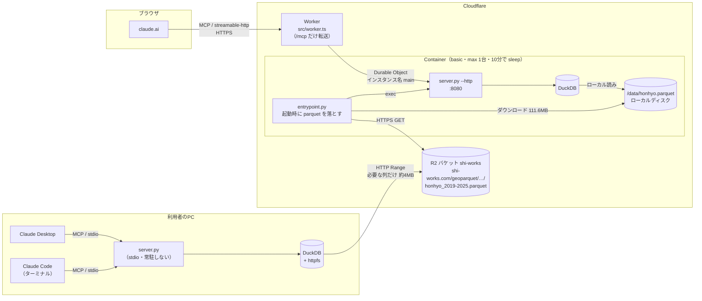
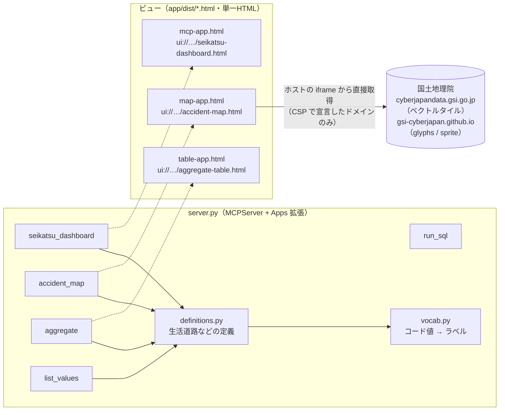
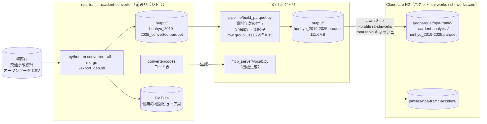

# システム構成

いま動いている構成を図にしたもの。質問1つで何が起きるかは [HOW_IT_WORKS.md](HOW_IT_WORKS.md)、
方式決定の経緯は [DESIGN.md](DESIGN.md) にある。

---

## 1. 実行時の構成

利用者の Claude からデータまでの経路は2通りある。**どちらも同じ `mcp_server/server.py`** で、
違うのはサーバーの置き場所とデータの読み方だけ。

| | ローカル（stdio） | claude.ai（Cloudflare） |
|---|---|---|
| クライアント | Claude Code / Claude Desktop | claude.ai |
| サーバーの場所 | 利用者のPC。クライアントが子プロセスとして起動する | Cloudflare Containers。Worker が転送する |
| データの読み方 | httpfs で R2 を HTTP Range 読み（約4MB） | 起動時に parquet 全体を `/data` に落としてローカル読み |
| なぜその読み方か | 転送量が小さく、手元の回線なら数秒で返る | コンテナから httpfs で読むと往復回数が効いて 53 秒かかった。ローカルなら 0.4 秒 |
| 認証 | 不要（外に出ない） | `SECRET_PATH` 設定時は `/s/<秘密>/mcp` 以外を 404 |
| 手順 | [SETUP_WINDOWS](SETUP_WINDOWS.md) / [SETUP_MAC](SETUP_MAC.md) | [deploy/cloudflare/](../deploy/cloudflare/README.md) |

補足:

- Worker は `getContainer(env.MCP_CONTAINER, "main")` で**常に同じ1台**に送る。
  MCP のセッションはコンテナのメモリ上にあるため
- コンテナが寝るとディスクも消える。起きるたびに parquet を落とし直す（コールドスタート十数秒）
- 旧方式（手元の `server.py --http` を `cloudflared` の quick tunnel で公開）は図に含めていない。
  [REMOTE_CONNECTOR.md](REMOTE_CONNECTOR.md) 参照

---

## 2. ツールとビュー

MCP サーバーが公開するツールは5つ。うち3つは MCP Apps のビュー（`ui://` リソース）を持ち、
iframe を持つホスト（Claude Desktop・claude.ai）でだけ描画される。
Claude Code では同じツールが数字だけを返す。

| ツール | ビュー | 外部通信 | 用途 |
|---|---|---|---|
| `seikatsu_dashboard` | 生活道路ダッシュボード | なし | 生活道路の経年推移（全事故を母数に併記） |
| `accident_map` | 事故地点マップ（MapLibre GL） | 地理院タイル | 絞り込んだ事故の点地図（既定 5,000・上限 20,000 点） |
| `aggregate` | 集計表 | なし | 条件で絞って集計。主にこれを使う |
| `list_values` | — | — | 列が取りうる値とコードの一覧 |
| `run_sql` | — | — | 生 SQL。似た別文字のリテラルは自動修復して `corrections` で返す |

生活道路の定義（strict / broad）は `definitions.py` だけが持つ。絞り込み・注記・
Claude に渡す説明文に加え、ビューの切り替えボタンもツールの返り値（`choices`）から作る。

ビューは `mcp_server/app/` を Vite + `vite-plugin-singlefile` で1枚の HTML に畳み込んだもの
（`npm run build`）。サンドボックス iframe は外部アセットを取りに行けないため、
JS/CSS はすべて HTML に埋め込まれている。

---

## 3. データを作る流れ

新年次を追加するときだけ動く。実行時の構成とは独立している。

- `資料年次` は前段の出力に無い。単年 CSV の行数を積み上げた区間で付与する（`--verify` で照合）
- ファイル名に年次範囲が入るので、年次を足すと**新しいキー**になる。
  immutable キャッシュのまま古い版と混ざらない
- 全 2,182,298 件の点表示は PMTiles + 既存ビューア（前段リポジトリ）の担当で、
  このリポジトリの `accident_map` とは別物
- 手順の詳細は [README](../README.md) の「データ更新」
